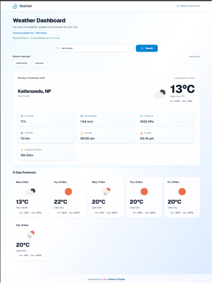

# ☁️ SkyCast – Weather Dashboard

A responsive, full-stack weather application that provides real-time weather information and forecasts for cities around the world.

**Live Demo:** https://skycast-frontend-one.vercel.app/

**Backend API:** https://skycast-backend-mu.vercel.app/

---

## 📸 Screenshots




---

## ✨ Features

- **Current Weather:** View real-time weather conditions for any supported city.
- **Weather Forecast:** View upcoming weather forecasts.
- **Detailed Weather Information:** Temperature, feels-like temperature, humidity, wind speed, pressure, visibility, sunrise, sunset and daylight duration.
- **Recent Searches:** Quickly revisit previously searched cities.
- **Persistent Search History:** Recent searches are saved using browser localStorage.
- **Responsive Design:** Optimized for desktop, tablet and mobile devices.
- **API Caching:** Backend caching reduces unnecessary requests to the weather provider.
- **Error Handling:** Handles invalid cities, API failures and connection errors.

---

## 🛠️ Tech Stack

### Frontend
- React
- Vite
- JavaScript
- Tailwind CSS v4
- shadcn/ui
- Lucide React
- Axios

### Backend
- Python
- Flask
- Flask-CORS
- Flask-Caching
- Requests

### External Services & Deployment
- OpenWeather API
- Git and GitHub
- Vercel

---

## 🏗️ Application Architecture

```text
                 USER
                   |
                   v
          React + Vite Frontend
                   |
                   | Axios HTTP Requests
                   v
             Flask Backend
                   |
          +--------+--------+
          |                 |
          v                 v
    Weather Routes     Forecast Routes
          |                 |
          v                 v
     Weather Service / API Caching
          |
          v
      OpenWeather API
          |
          v
       JSON Response
          |
          v
      React Dashboard
```

### Project Structure

```text
SkyCast/
│
├── backend/
│   ├── app/
│   │   ├── routes/
│   │   │   ├── weather_routes.py
│   │   │   └── forecast_routes.py
│   │   │
│   │   ├── services/
│   │   │   └── weather_service.py
│   │   │
│   │   └── __init__.py
│   │
│   ├── index.py
│   ├── run.py
│   ├── requirements.txt
│   └── .gitignore
│
├── frontend/
│   ├── public/
│   ├── src/
│   │   ├── app/
│   │   ├── components/
│   │   ├── features/
│   │   ├── lib/
│   │   ├── services/
│   │   ├── styles/
│   │   └── utils/
│   │
│   ├── package.json
│   └── vite.config.js
│
└── README.md
```

---

## ⚙️ Getting Started

Follow these instructions to run SkyCast locally.

### Prerequisites

- Node.js and npm
- Python 3
- Git
- OpenWeather API key

### 1. Clone the repository

```bash
git clone https://github.com/abhinavtee/SkyCast.git

cd SkyCast
```

### 2. Configure the backend

Navigate to the backend directory:

```bash
cd backend
```

Create a virtual environment:

```bash
python -m venv venv
```

Activate it using Git Bash on Windows:

```bash
source venv/Scripts/activate
```

Install dependencies:

```bash
pip install -r requirements.txt
```

Create a `.env` file inside the backend directory:

```env
OPENWEATHER_API_KEY=your_openweather_api_key
FLASK_DEBUG=true
FRONTEND_URL=http://localhost:5173
```

Start the backend:

```bash
python run.py
```

Backend URL:

`http://127.0.0.1:5000`

### 3. Configure the frontend

Open a second terminal and navigate to the frontend directory:

```bash
cd frontend
```

Install dependencies:

```bash
npm install
```

Create a `.env` file inside the frontend directory:

```env
VITE_API_BASE_URL=http://localhost:5000/api
```

Start the development server:

```bash
npm run dev
```

Frontend URL:

`http://localhost:5173`

---

## 🔌 API Endpoints

| Method | Endpoint | Description |
|---|---|---|
| GET | `/api/health` | Backend health check |
| GET | `/api/weather?city=Lucknow` | Current weather |
| GET | `/api/forecast?city=Lucknow` | Weather forecast |

---

## ⚡ Caching

SkyCast uses Flask-Caching with SimpleCache to temporarily store weather API responses.

- Current weather: 5 minutes.
- Forecast: 10 minutes.

This helps reduce repeated external API requests.

---

## 🔐 Environment Variables

Sensitive configuration values are stored in environment variables.

| Variable | Purpose |
|---|---|
| `OPENWEATHER_API_KEY` | OpenWeather API authentication |
| `FLASK_DEBUG` | Flask debug configuration |
| `FRONTEND_URL` | Allowed frontend origin for CORS |
| `VITE_API_BASE_URL` | Backend API base URL used by the frontend |

**Security:** Never commit `.env` files, API keys, or other secrets to GitHub.

---

## 🚀 Deployment

SkyCast is deployed on Vercel.

| Application | Platform | URL |
|---|---|---|
| Frontend | Vercel | https://skycast-frontend-one.vercel.app/ |
| Backend | Vercel | https://skycast-backend-mu.vercel.app/ |

---

## 👨‍💻 Author

**Abhinav Tripathi**

Full Stack Developer

- GitHub: [@abhinavtee](https://github.com/abhinavtee)
- Project: [SkyCast](https://github.com/abhinavtee/SkyCast)
- Live Application: [SkyCast Weather Dashboard](https://skycast-frontend-one.vercel.app/)

---

*Built with ☁️ and code.*
